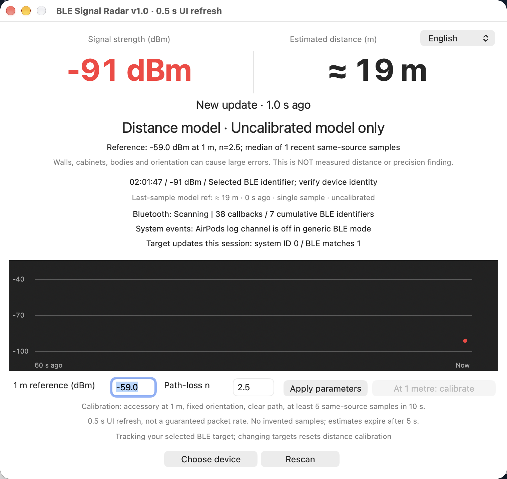

# BLE Signal Radar

English | [中文](README.zh-CN.md)

**Version 0.1.1**

When you can't find your headphones, move your Mac around and watch the signal: it helps you tell roughly where the device is and narrow down the search area.

> **A displayed battery percentage does not prove proximity.** It may be cached. Only new advertisements/system updates provide current signal clues. This app does not replace Find My, provide GPS or directional finding, force a sound, or guarantee an accurate distance.

## Screenshot



A user-provided runtime capture (cropped, before the tracking-target header was added), not simulated data. The large columns show RSSI and model distance side by side; `--` means no fresh target sample is available. The separate last-sample model reference is explicitly historical when stale. See also [the cropped Chinese runtime detail](README.zh-CN.md#运行截图). Neither readout is a verified physical distance.

## Features

- **Generic BLE target picker:** recent advertised names, scan identifiers, RSSI, sample age and company IDs. Enable or hide the **Model m (uncal.)** column for all scanned devices; this option is saved locally. Select any fresh BLE identifier to track—it does not have to be an AirPods device.
- **Selected target at the top:** device name when available and full BLE identifier, selectable/copyable with a full-text tooltip. The selected identity remains visible without fresh samples; after restart the identifier appears immediately and the name returns when discovered. Selection does not prove current presence or ownership.
- **Live Chinese / English switching** with locally saved preference.
- **Freshness and provenance:** large dBm reading, source, last update and 60-second chart. Clear current RSSI and distance after 5 seconds without updates. A separate last-sample model reference remains visible with its age and an explicit historical/not-current label.
- **Side-by-side signal and distance:** large RSSI (dBm) and estimated-distance (m) columns. The distance model uses recent same-source median RSSI, an adjustable 1 m reference and path-loss exponent, plus user-confirmed 1 m reference calibration. Both current readouts show `--` when no fresh target sample is available.
- **Optional AirPods helpers:** exact target-ID events from `bluetoothd` and historical Apple payload matching. Never assume every nearby Apple device is yours.
- No device connections, sound commands, Bluetooth/location setting changes or data uploads.

## Compatibility

| Device/state | Support |
| --- | --- |
| BLE earphones, tags, keyboards, sensors, etc. currently advertising and exposed by macOS CoreBluetooth | Select a scan identifier and try tracking it; **not per-model certification** |
| Certain Apple/Beats earphones (models intentionally not listed) | Fresh advertisements and system events have been observed on one Mac during an actual search for some models; not guaranteed across firmware/macOS versions, and models are not individually verified |
| Classic-Bluetooth-only, powered-off, dead or non-advertising devices | Cannot be located with this tool |
| Cached battery/connection records only | Not evidence of current proximity |

Discovery-list distances use the same **uncalibrated default assumptions** (-59 dBm at 1 m, n=2.5) for each device, never another target's calibration. They use the last raw RSSI, not the main view's recent median, and show `--` after five seconds without an update. Different transmitter powers make these values unsuitable for comparing actual distances between devices. Select your own verified target and set its 1 m reference if appropriate.

Names, company IDs and RSSI do not authenticate ownership. Compare a known device while moving it before choosing. Addresses/scan identifiers may rotate, requiring target reselection.

## Run locally

Requires macOS 13+, Xcode Command Line Tools and Bluetooth permission. Uses only AppKit, CoreBluetooth and Foundation; no Python or third-party packages.

```bash
./test.sh
./build.sh
open "BLE Signal Radar.app"
```

Allow Bluetooth access when prompted, or in System Settings → Privacy & Security → Bluetooth. Click **Choose device**, independently verify your target, then **Track selection**. No prior audio connection or pairing is required for scanning.

Keep the Mac's orientation reasonably consistent and collect several fresh samples per location. An isolated signal peak does not mean “within one metre.” The UI refreshes every 0.5 s; advertisement delivery is not guaranteed at that rate.

Closing the window or Cmd+Q stops scanning and terminates this app's log-stream subprocess. Quit an old instance before opening a rebuilt app. Local builds are ad-hoc signed, not Developer ID signed or notarised.

## Distance is a model, not a measurement

The log-distance path-loss model is:

```text
distance_m = 10 ^ ((RSSI_at_1m - measured_RSSI) / (10 × n))
```

Defaults are `RSSI_at_1m = -59 dBm` and `n = 2.5`: **assumptions, not measured universal AirPods specifications**. The estimator uses the median of up to nine samples from the latest source within ten seconds, and displays no distance once the latest sample expires.

The current estimate uses the recent-sample median. A separate **last-sample model reference** uses the last raw RSSI and current parameters, even after that observation becomes stale. For example, **-46 dBm → approximately 0.3 m** under the default assumptions. Its age and uncalibrated status remain explicit; it is not a current location or physical distance. This reference lasts only for the running session; restarting waits for a new target sample.

These are outputs of the default formula, **not measured distance mappings**:

| RSSI | Default model output |
| --- | --- |
| -50 dBm | ~0.4 m |
| -60 dBm | ~1.1 m |
| -70 dBm | ~2.8 m |
| -80 dBm | ~6.9 m |
| -90 dBm | ~17.4 m |

Walls, cabinets, bodies, reflections, transmitter power and antenna orientation can cause very large errors. A single RSSI cannot uniquely determine physical distance or the room containing a device.

### Set a 1 m reference

1. Place the **verified target** about 1 m from the Mac, with a clear path and fixed orientation.
2. Wait for at least five same-source samples within the last ten seconds; the calibration button then becomes available.
3. Click **At 1 metre: calibrate**, confirm, and save the recent median as the 1 m reference.
4. The exponent n remains assumed. Setting a 1 m reference cannot remove environmental errors. Changing targets resets calibration. Do not calibrate at an unknown physical distance.

## Optional AirPods helper configuration

Generic BLE selection needs no manual configuration. For the optional AirPods system-ID/historical-payload mode:

```bash
cp config.example.json config.local.json
# Replace fictional values with identifiers independently verified as yours, then restart.
```

- The example's UUID and payload are **fictional**; they will not automatically identify your device.
- `caseIdentifier`: exact `bluetoothd` accessory ID filter.
- `accessoryPayloadPrefix`: historical Apple `0x07` TLV payload prefix, excluding the mutable `0x12` frame. It may rotate and is not authentication.
- `peripheralIdentifier`: selected CoreBluetooth UUID. When set, only this identifier is tracked; AirPods system/payload channels are not mixed in.
- `language`: `zh` / `en`; otherwise the system's first preferred language is used.
- `showDiscoveryDistances`: show/hide the uncalibrated distance column in the generic discovery list (default `true`).
- `distance`: reference RSSI, exponent n and whether the user has confirmed setting a 1 m reference.

Only target events emitted after launch are consumed; repeated `AdTsMC` values are deduplicated. `AdTsMC` is a system time-related field, not an accessory-transmitted packet counter. Events can be delayed/coalesced, and macOS log formats/permissions and Apple advertisement formats can change. The app cannot bypass system restrictions on third-party advertisement visibility.

Settings live in `config.local.json` beside the `.app`. When launching the executable directly, `SIGNAL_RADAR_CONFIG` can specify another path. Identifiers, fingerprints and reference calibration stay local; `*.local.json` is gitignored and must not be committed.

## Other limitations

- Cumulative BLE identifiers are not a count of physical devices currently present. Departures do not decrement it, and rotating identifiers can inflate it.
- Missing samples may mean throttling, changed advertisements, identifier rotation, obstruction or loss of range—not necessarily that the accessory was moved away.
- Charts contain actual samples only. Gaps over three seconds are not connected; missing samples are never invented.
- This is a **macOS app**, not an iPhone app. Viewing Mac readings remotely on a phone does not move the receiving antenna to the phone.

## Verification and source

`./test.sh` covers TLV parsing, target rejection, deduplication/order/freshness, distance mathematics, configuration, bilingual validation/target labels, observation metadata and chunked log framing. Tests do not inject fake radio data into the GUI. Formula correctness does not establish physical ranging accuracy. Screenshots come from real runs; target-picker UI, English validation alerts and stale display were checked locally.

- `Sources/App/`: application lifecycle and backward-compatible local settings.
- `Sources/Core/`: platform-independent observation metadata, typed payload envelope and backend contract.
- `Sources/Backends/BLE/`: CoreBluetooth collection and generic discovery models.
- `Sources/Backends/AirPods/`: optional Apple payload/log parsing, deduplication and owned log subprocess.
- `Sources/Analysis/`: existing BLE-oriented RSSI history, median and distance model.
- `Sources/UI/`: window controller, generic target picker and graph; layout is unchanged.
- `Tests/`, `test.sh`: offline regressions; the shared core also compiles independently.
- `build.sh`, `Resources/`: app packaging and localized Bluetooth permission descriptions.
- `docs/`: actual runtime screenshots and the [architecture / staged expansion plan](docs/architecture.md).

The structural foundation uses typed observations from both existing collectors. It does **not** implement SDR reception, recording/replay, remote collection, spectrum detection, mapping or localization. Those remain separately scoped stages. Root `recordings/` and `exports/` are ignored as a privacy precaution, not evidence that recording exists.
