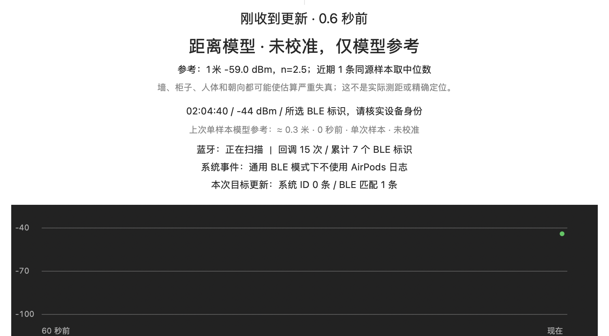

# BLE Signal Radar · BLE 信号雷达

[English](README.md) | 中文

**版本 0.1.1**

一个 macOS 悬浮小工具：**当耳机或其他 BLE 配件找不到、Find My 不显示位置或无法连接，但设备仍在发广播时，用新收到的 RSSI 辅助缩小搜索范围。** 不限特定耳机型号，也不依赖建立音频连接。

> **显示电量不代表设备就在附近。** 电量可能是配对记录的缓存；只有新的广播/系统更新才提供当前信号线索。本工具不是 Find My 替代品，不提供 GPS、方向箭头、强制发声或保证准确的距离。

## 运行截图



真实本机运行局部截图，展示中文模型状态、RSSI 样本参考与曲线，未注入模拟信号；顶部双列读数和底部按钮见用户提供的英文运行截图（边缘有裁剪，拍摄时尚未新增追踪目标标题栏）。没有新的目标样本时当前值显示 `--`；“上次单样本模型参考”过期后明确标记为历史值，不能作为当前或实际距离。候选匹配也不等于身份认证。

英文界面运行截图见 [English README](README.md#screenshot)。

## 功能

- **通用 BLE 目标选择**：列出最近 60 秒发现的名称、扫描标识、RSSI、样本年龄和厂商代码；可勾选显示/隐藏所有扫描设备的“估算米数（未校准）”列，选项保存在本地。可选择任何新收到广播的 BLE 标识进行追踪，不限 AirPods。
- **中英即时切换**：窗口右上角选择中文 / English，设置保存在本地。
- **真实数据与新鲜度**：大号 dBm、来源、最后更新时间和 60 秒曲线；5 秒无更新便清空当前 RSSI 和距离估算。单独保留带年龄的“上次单样本模型参考”，明确标记“历史，非当前”。
- **信号与距离双列显示**：并排大字显示 RSSI（dBm）和估算距离（米）。距离模型使用近期同源 RSSI 中位数，可调 1 米参考 RSSI 和路径损耗系数 n，支持用户确认的 1 米参考校准；没有新的目标样本时，两列当前值均显示 `--`。
- **AirPods 辅助通道**：可选的 `bluetoothd` 目标 ID 事件和历史 Apple 广播负载匹配；不把所有 Apple 设备当成你的耳机。
- 不连接设备、不发声、不修改蓝牙或定位开关、不上传数据。

## 支持范围

| 设备/状态 | 支持情况 |
| --- | --- |
| 正在广播、macOS 能公开给 CoreBluetooth 的 BLE 耳机、标签、键盘、传感器等 | 可选择扫描标识并尝试追踪；**不是逐型号认证** |
| 部分 Apple/Beats 耳机（有意不列具体型号） | 已在一台 Mac 上实测部分型号可接收广播和系统事件，用于辅助寻找；不保证所有固件/系统均可用，未逐型号验证 |
| 仅经典蓝牙、关机、没电或不广播的设备 | 无法通过本工具寻找 |
| 只剩旧电量、旧连接记录 | 不能由此推断位置或附近有信号 |

发现列表的距离统一使用**未校准默认参数**（1 米 -59 dBm、n=2.5），不套用其他目标的校准。它按每行最后一条原始 RSSI 计算，而非主窗口的近期中位数；超过 5 秒无更新则显示 `--`。不同设备发射功率不同，不能据此比较其实际远近。选定并核实自己的目标后，可单独设置 1 米参考。

名称、厂商代码和信号强弱不能证明设备归属。可先对一个已知设备做移动/远近对照来确认。广播地址/系统扫描标识可能轮换；失去目标后可能需要重新选择。

## 本地运行

需要 macOS 13+、Xcode Command Line Tools 和蓝牙权限。仅使用系统 AppKit、CoreBluetooth、Foundation，不需要 Python 或第三方包。

```bash
./test.sh
./build.sh
open "BLE Signal Radar.app"
```

首次提示蓝牙访问时允许，或前往“系统设置 → 隐私与安全性 → 蓝牙”。未配置目标时，点击 **选择设备**，先核实目标，再选择“追踪所选目标”。无需先连接或配对耳机。

保持电脑朝向相对固定，在不同位置等待多个**新样本**，再比较强弱。不要把偶发峰值等同于“一米内”。0.5 秒只是界面刷新周期，系统并不保证每 0.5 秒收到广播。

关闭窗口或 Cmd+Q 会停止扫描，并终止本应用启动的系统日志子进程。重新构建后需退出旧实例再打开；构建产物只临时签名，尚未做 Developer ID 签名或公证。

## 距离估算：只能作为模型参考

采用对数距离路径损耗模型：

```text
distance_m = 10 ^ ((RSSI_at_1m - measured_RSSI) / (10 × n))
```

默认 `RSSI_at_1m = -59 dBm`、`n = 2.5`，**两者都是假设，不是测得的 AirPods 通用参数**。使用最近 10 秒内至多 9 条、与最新样本同源的 RSSI 取中位数；最新数据过期则不显示距离。

当前估算使用近期样本中位数。单独的“上次单样本模型参考”按最后一条原始 RSSI 和当前参数计算，即使样本已过期也显示其年龄和未校准状态。例如默认参数下 **-46 dBm → 约 0.3 米**，并非当前或实际距离。该参考只保留在运行会话内，重启后需等待新的目标样本。

下表只是默认公式的输出，**不是实测距离对照表**：

| RSSI | 默认模型输出 |
| --- | --- |
| -50 dBm | 约 0.4 m |
| -60 dBm | 约 1.1 m |
| -70 dBm | 约 2.8 m |
| -80 dBm | 约 6.9 m |
| -90 dBm | 约 17.4 m |

墙体、柜子、人体、反射、设备发射功率和天线朝向都可能造成很大偏差；单个 RSSI 无法唯一反推出实际距离，也不能据此判断在哪个房间。

### 1 米参考校准

1. 将**已确认的目标**放到距电脑约 1 米、无遮挡的位置，固定朝向。
2. 等待最近 10 秒内至少 5 条同源新样本，校准按钮才可用。
3. 点击“已放在1米：校准”，确认后保存近期中位数为 1 米参考值。
4. n 仍是假设；校准 1 米参考不能消除柜子/墙体和换环境的误差。更换目标会重置校准。不要在不知道真实距离时点击校准。

## 可选 AirPods 辅助配置

通用 BLE 模式无需手工编辑配置。AirPods 的系统事件/历史指纹通道可以单独配置：

```bash
cp config.example.json config.local.json
# 用已核实属于你的设备的标识替换示例值，然后重新启动应用。
```

- 示例 UUID 和指纹均为**虚构值**，不会自动识别你的设备。
- `caseIdentifier`：精确筛选 `bluetoothd` 的 `Accessory found` 目标 ID。
- `accessoryPayloadPrefix`：Apple `0x07` TLV 的历史负载前缀；不包含可变 `0x12` 状态帧。负载可能轮换，匹配不等于身份认证。
- `peripheralIdentifier`：手动选择的 CoreBluetooth UUID；存在时仅追踪该标识，不混用 AirPods 系统/指纹通道。
- `language`：`zh` / `en`，未设置则跟随系统首选语言。
- `showDiscoveryDistances`：是否显示通用发现列表的未校准估算距离列，默认为 `true`。
- `distance`：参考 RSSI、n 和是否由用户确认设置了 1 米参考。

只消费本次启动后的目标事件；相同 `AdTsMC` 去重。`AdTsMC` 是系统时间相关字段，不是耳机发来的广播序号；系统事件也可能合并或延迟。macOS 日志格式/权限和 Apple 广播格式可能变化。第三方应用看不到广播时，本工具无法绕过系统限制。

配置保存在 `.app` 同目录的 `config.local.json`；直接运行可执行文件时也可用 `SIGNAL_RADAR_CONFIG` 指定其他位置。设备标识、指纹和校准信息只保存在本地，`*.local.json` 已忽略，不应提交到仓库。

## 其他边界

- “累计 BLE 标识”不是当前在场的实物设备数；离开的不减，轮换标识可能被重复计入。
- 无新样本可能是扫描节流、广播改变、标识轮换、遮挡或离开范围，不能直接认定设备被拿走。
- 曲线只画实际样本，间隔超过 3 秒不连线；没有数据就显示空白，不补点。
- 当前是 **macOS 应用**，不是 iPhone 应用；手机远程显示 Mac 读数也不会改变测量天线的位置。

## 验证与项目结构

窗口顶部显示所选目标的名称（发现记录中可用时）和完整 BLE 标识，可选择复制，悬停可查看全文。即使没有新信号仍保留目标标识；重启先显示标识，收到发现记录后恢复名称。所选身份不代表当前在场或所有权认证。

`./test.sh` 验证广播 TLV 解析、错误目标拒绝、样本去重/排序/过期、距离公式、配置、中英错误/目标提示、观测元数据和分块日志解析；测试不向 GUI 注入信号。公式测试通过不等于物理测距已验证。截图来自实际运行；通用设备选择、英文错误弹窗和过期显示也进行了本机界面检查。

- `Sources/App/`：应用生命周期和兼容原格式的本地配置。
- `Sources/Core/`：不依赖界面或接收器框架的观测元数据、类型化载荷和后端协议。
- `Sources/Backends/BLE/`：CoreBluetooth 采集与通用发现模型。
- `Sources/Backends/AirPods/`：可选 Apple 负载/日志解析、去重和日志子进程管理。
- `Sources/Analysis/`：现有 BLE RSSI 历史、中位数与距离模型。
- `Sources/UI/`：窗口控制器、设备选择器和曲线；界面布局不变。
- `Tests/`、`test.sh`：离线回归测试，并单独编译共享核心。
- `build.sh`、`Resources/`：应用打包和本地化蓝牙权限说明。
- `docs/`：实际运行截图与[英文架构及分阶段扩展计划](docs/architecture.md)。

本轮仅建立结构基础，两个现有采集通道均使用类型化观测；尚未实现 SDR、录制/回放、远程采集、频谱检测、地图或定位。根目录 `recordings/` 和 `exports/` 的忽略规则只是隐私预防措施，不代表已有录制功能。
